# Hexapod spider robot

**English** · [Português](README.pt-BR.md)

A 3D-printed six-legged robot with 18 servos, driven from an Android phone over Wi-Fi. An ESP32 runs the real-time control and the safety failsafe; a Raspberry Pi bridges the app, streams the camera and shows its status on a small screen.

<p align="center">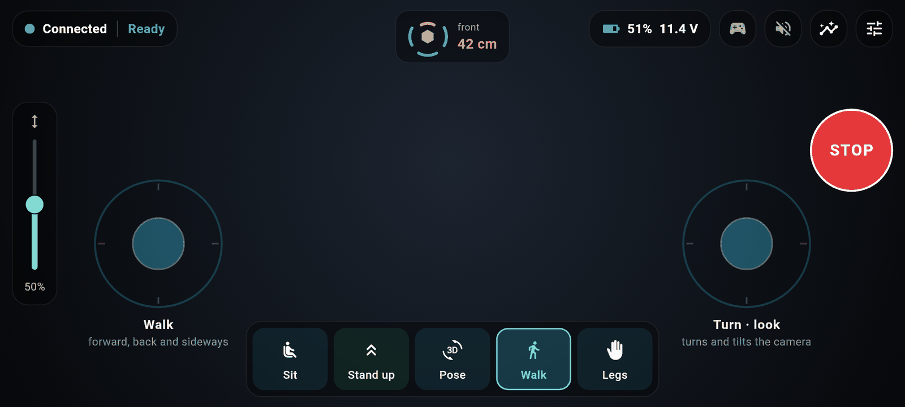</p>

There are two ways in, on purpose:

- **Simple path:** flash a ready-made SD card image, switch the robot on, and set everything up from the phone: pairing, Wi-Fi, updates. No terminal, no computer skills needed.
- **Maker path:** everything stays open: SSH into the Pi, Ansible provisioning, a deploy script with automatic rollback, a simulator, metrics, and the source of every part.

> **Status:** in development. The app, the Pi side and the firmware run on a bench setup (Pi 3 + a classic ESP32 standing in for the ESP32-S3), with GPS and the status screen wired. Servos and most sensors are being installed. Nothing here moves a servo unless the pilot asks for it.

## Contents

- [Features](#features)
- [Screens](#screens)
- [Parts list](#parts-list)
- [Install: simple path](#install-simple-path)
- [Install: maker path](#install-maker-path)
- [Architecture](#architecture)
- [Development](#development)
- [Safety](#safety)
- [Languages](#languages) · [Credits](#credits) · [License](#license)

## Features

**Piloting**
- Drone-style landscape screen: two virtual sticks, body height slider, modes **Sit / Stand up / Pose / Walk / Legs** (wave, guard and strike gestures with the front legs).
- **PS5 DualSense** support: sticks, triggers, buttons, light bar color by robot state; the on-screen sticks hide while a controller is connected.
- Live camera (WebRTC) with optional robot microphone audio.
- Big **STOP** button, distance radar around the robot, battery, link quality and warnings in plain words with what to do next.
- Visual feedback in the middle of the screen (hold-to-stand ring, gesture cards), and bars that hide by themselves while you drive.

**Setup without a computer**
- **Pairing in seconds:** the robot's screen shows a QR code and a 5-character code; the app finds the robot (or joins its own Wi-Fi) and pairs. Each robot has its own key, so nobody else on the network can drive it.
- **Wi-Fi from the phone:** the robot opens its own network (`Hexapode-XXXX`) on first boot; to use your home network, pick it and type the password on the phone. A wrong password makes the robot fall back to its own network by itself.
- **Remote access from the app:** drive from anywhere (4G, another network) through Tailscale, set up with a login in the browser: [step by step](docs/remote-access.md).
- **Several robots** in one app ("My robots"), each with its own name.
- **Ready-made SD card image** that programs the ESP32 by itself on first boot.

**Data and health**
- Data screen in tabs: summary, orientation (artificial horizon), distance, **GPS position**, environment (temperature, humidity, pressure, **gas/smoke alarm**), leg angles, ESP32 health and the **Raspberry Pi's own health** (CPU, temperature, memory, SD card, power dips).
- **Status screen on the robot** (0.96" OLED): boot progress, network, IP, battery and the pairing code.
- Prometheus metrics at `/metrics` for makers who want dashboards.

**Safety and updates**
- Servos start powered off; a dead-man link (commands at 20 Hz) makes the robot stop, sit and relax by itself when the app goes quiet. The failsafe lives on the ESP32 and cannot be turned off remotely.
- Tilt, obstacle and low-battery protections on the robot itself.
- Updates only install with the robot sitting, flash the ESP32, check the new version answers within 10 s and roll back otherwise.
- The SD card can run read-only, so pulling the power never corrupts it.

**For everyone**
- App in **English and Brazilian Portuguese** (follows the phone, or pick one in Settings).

## Screens

Rendered from the app with a simulated robot (`cd app && make screenshots`), so they show every sensor fitted. Portuguese versions: [docs/screenshots/pt](docs/screenshots/pt).

| | |
|---|---|
| 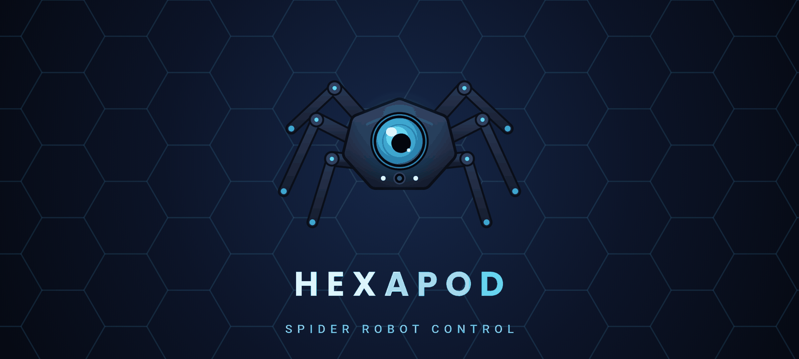 **Splash** | 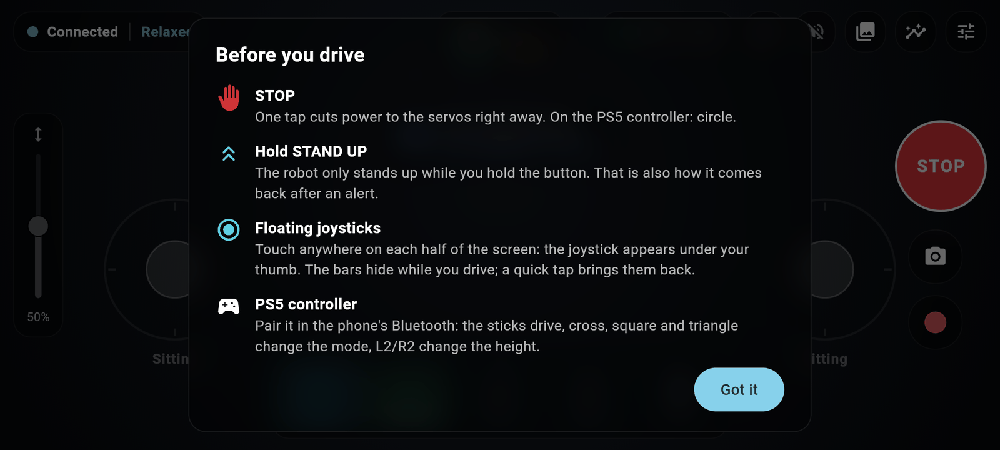 **First run tips** |
|  **Driving** | 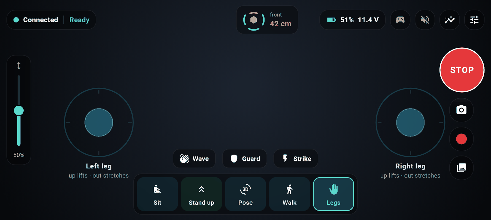 **Front legs: gestures** |
| 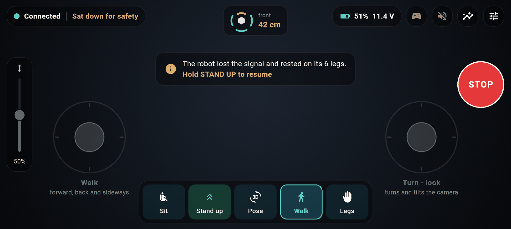 **Failsafe: it sat down by itself** | 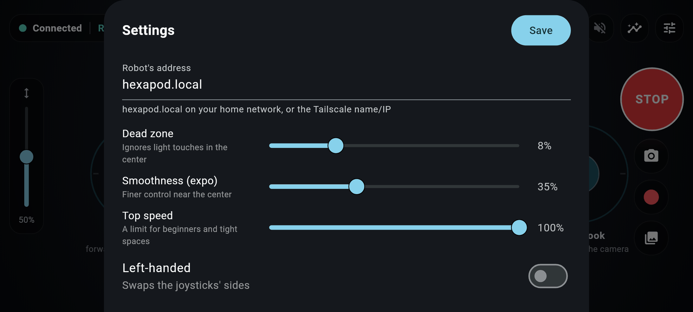 **Settings** |
| 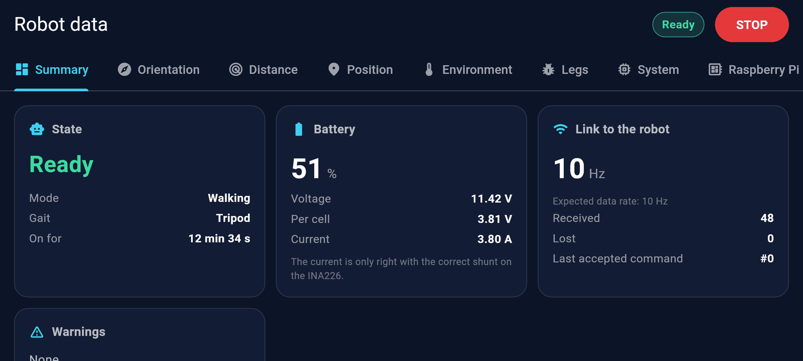 **Data: summary** | 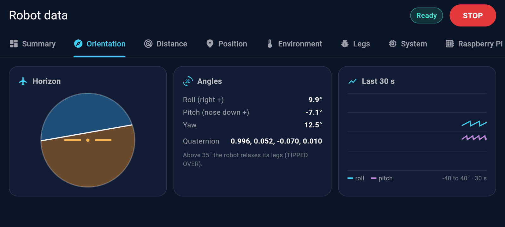 **Data: orientation** |
| 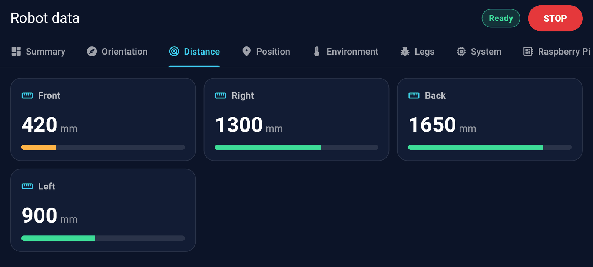 **Data: distance radar** | 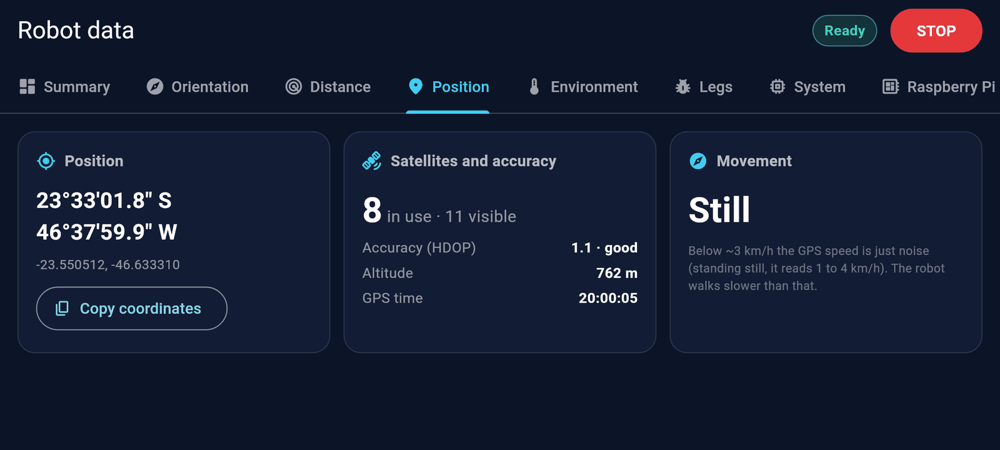 **Data: GPS** |
| 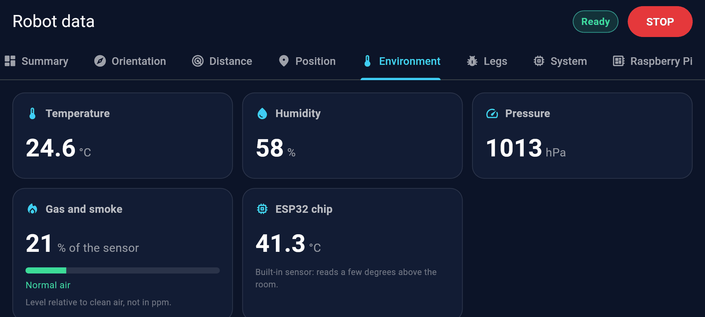 **Data: environment and gas** | 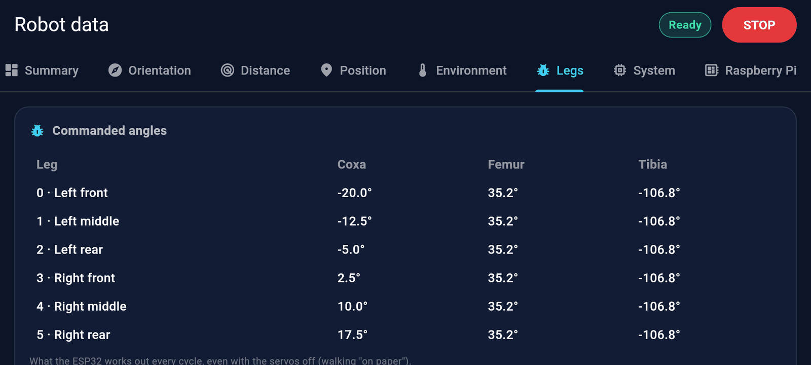 **Data: leg angles** |
| 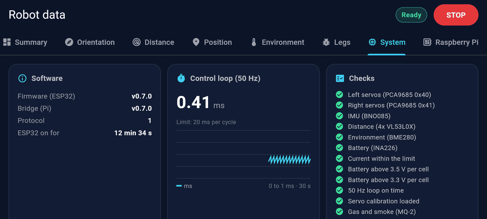 **Data: ESP32** | 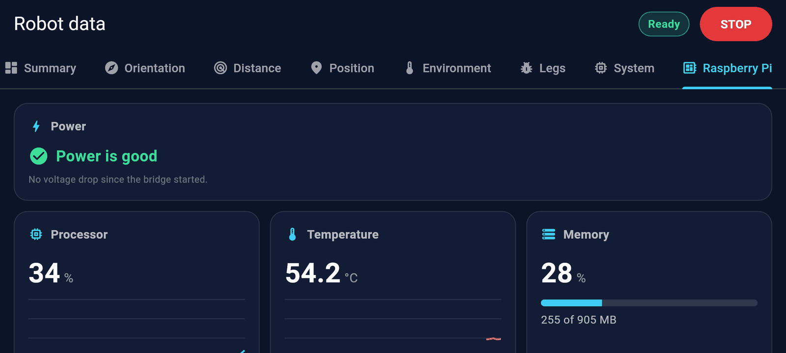 **Data: Raspberry Pi health** |
| 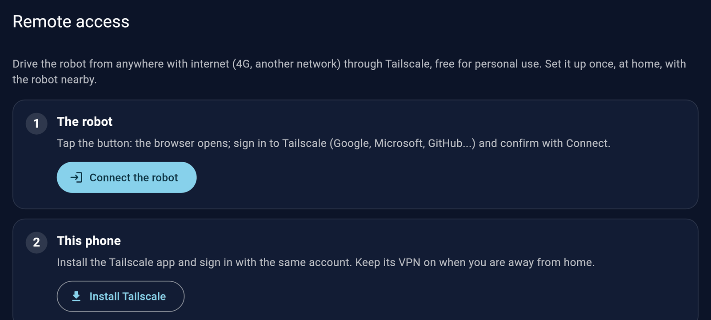 **Remote access: setup** | 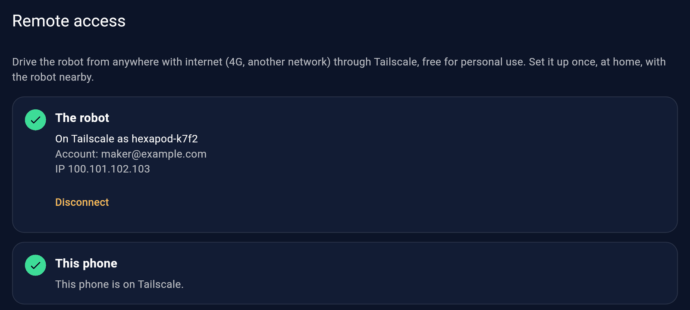 **Remote access: ready** |
| 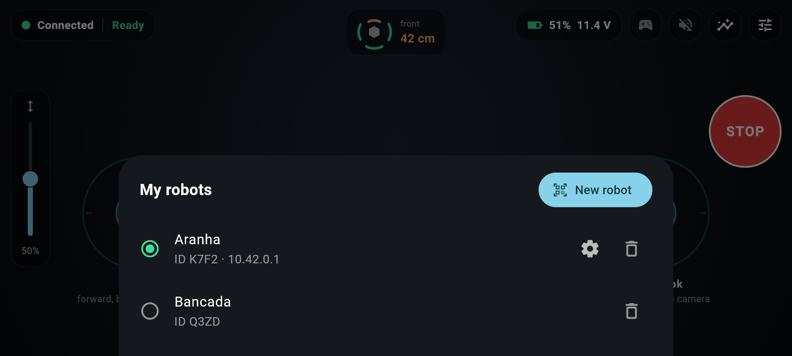 **My robots** | 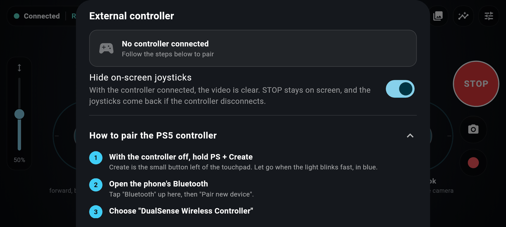 **PS5 controller** |
| 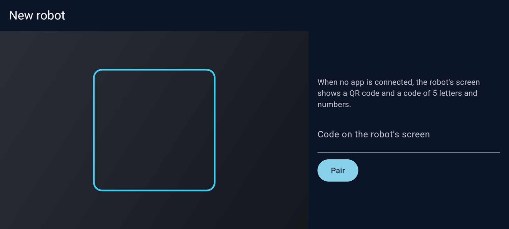 **Pairing by code** | 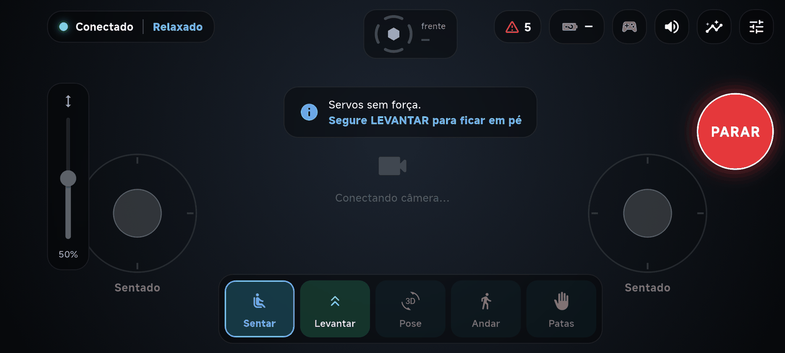 **On a real phone, bench robot (Portuguese)** |

## Parts list

**Mechanics**

| Qty | Part | Notes |
|---|---|---|
| 1 set | 3D-printed body and legs | From [*Hexapod Spider Robot with Servo & Arduino*](https://makerworld.com/en/models/1973965-hexapod-spider-robot-with-servo-arduino) by Emre Kalem (MakerWorld), with the body adapted for the electronics. See [`cad/`](cad/README.md) |
| 18 | MG996R servo | 3 per leg (coxa, femur, tibia), with their horns |
| 90 | M3 × 6 mm screw | |
| 90 | M3 × 10 mm screw | |
| 18 | 695 bearing (5 × 13 × 4 mm) | One per joint |

> **Our parts are modified.** The body is being reworked to hold this project's electronics and sensors (Raspberry Pi, ESP32, camera, the 4 distance sensors, IMU, screen, GPS). Those STLs are not published yet; they will go into [`cad/`](cad/README.md). Until then, the original model prints and assembles, but the electronics need your own mounts.

**Electronics**

| Qty | Part | Role |
|---|---|---|
| 1 | Raspberry Pi 3 Model B (or Pi 4) + microSD 16 GB or more | Bridge, video, Wi-Fi, status screen, GPS |
| 1 | ESP32-S3 SuperMini | Real-time control and failsafe (USB to the Pi) |
| 2 | PCA9685 16-channel PWM board (HW-170) | Servos: one per side (0x40 and 0x41) |
| 1 | BNO085 IMU | Orientation and fall detection |
| 4 | VL53L0X distance sensor (GY-VL53L0XV2) | Obstacle radar (front, right, rear, left) |
| 1 | BME280 | Temperature, humidity, pressure |
| 1 | INA226 | Battery voltage and current (**replace the 0.1 Ω shunt**, see below) |
| 1 | MQ-2 module | Gas and smoke (relative reading, informative alarm) |
| 1 | OV5647 camera, 120° wide angle | Video (CSI) |
| 1 | Mini USB microphone | Robot audio |
| 1 | GY-NEO6MV2 GPS (u-blox NEO-6M) | Position (Pi UART) |
| 1 | 0.96" SSD1306 OLED, I2C | Status screen and pairing code |
| — | WS2812 LEDs (optional) | State lights (to be decided) |

**Power**

| Qty | Part | Notes |
|---|---|---|
| 1 | LiPo 3S 2200 mAh, XT60 | Main battery |
| 1 | 20 A fuse + anti-spark switch | Right after the battery |
| 1 | Step-down 20 A, set to 6.0 V | Servo power (PCA9685 V+) |
| 1 | Mini560 Pro 5 V / 5 A | Logic: Pi (GPIO 5 V), ESP32, sensors |

Wiring and pins: [`firmware/PINOUT.md`](firmware/PINOUT.md).

> **INA226 shunt:** most modules ship with a 0.1 Ω shunt that only measures up to ~0.8 A. The robot draws several amps: use a 2 mΩ shunt (up to ~40 A) or an external 50–75 mV shunt, and set its value in `firmware/include/config.h`.

## Install: simple path

What you need: the assembled robot, a microSD card (16 GB or more), a PC with a card reader, and an Android 10+ phone.

1. **Flash the card.** Download `hexapod-<version>-esp32s3.img.xz` from the project's **Releases** page. In **Raspberry Pi Imager**: device *Raspberry Pi 3* → *Choose OS* → *Use custom* → the downloaded file → your card → *Write*. No need to unzip it or to customize anything.
2. **Switch the robot on.** The small screen shows *HEXAPOD · INICIANDO* and ticks off the system, the network, the ESP32 and the bridge (the robot's screen is in Portuguese for now). **The first boot takes about 2 minutes**: the robot fits the card and programs the ESP32 by itself. Don't switch it off meanwhile.
3. **Install the app** (Google Play soon; for now the APK from Releases).
4. **Pair.** Open the app → **Pair a robot** → point the camera at the QR code on the robot's screen, or type the 5-character code shown next to it. If Android asks to join the network **Hexapode-…**, tap **Connect**. Done: **Paired!**
5. **Home Wi-Fi (optional).** *Settings → Robot's network (Wi-Fi) → Connect to a network*, choose yours and type the password (2.4 GHz networks on a Pi 3). It is stored only on the robot. Without it, the robot keeps its own network, which works anywhere, even in a backyard with no router.

| Problem | What to do |
|---|---|
| The small screen stays dark or blinks | Almost always power: use the official Pi supply (5.1 V / 2.5 A) on the bench; a phone charger is not enough |
| The app doesn't find the robot | Phone and robot must be on the same network, or type the IP shown on the robot's screen |
| "Wrong or expired code" | Use the code on the screen **now**: it changes every 10 minutes and after each use |
| The **Hexapode-…** network doesn't show up | The Pi's Wi-Fi didn't start: check the power, wait a minute after switching on |
| The screen says **ESP32 sem resposta** (ESP32 not answering) | Check the USB cable between the Pi and the ESP32 |

Full guide: [`docs/install.md`](docs/install.md). Remote access (drive away from home): [`docs/remote-access.md`](docs/remote-access.md).

## Install: maker path

Everything the simple path does, by hand and under your control. **Full guide: [`docs/maker-install.md`](docs/maker-install.md)**; the short version:

**1. Prepare the Pi** from stock Raspberry Pi OS Lite 64-bit (hostname `hexapod`, your user and SSH key), then provision it with Ansible from your PC:

```bash
cd pi/provision
ansible-playbook site.yml --check --diff   # dry run
ansible-playbook site.yml                  # camera, MediaMTX, hexd service, udev, I2C/UART, watchdog...
ssh wallace@hexapod.local 'bash -s' < check.sh   # validation
```

Details, the read-only card and Tailscale: [`pi/provision/README.md`](pi/provision/README.md).

**2. Build and install a release** (hexd + ESP32 firmware, one package):

```bash
BOARD=esp32s3 pi/deploy/package.sh                  # dist/hexapod-<version>.tar.gz
scp dist/hexapod-<version>.tar.gz wallace@hexapod.local:/tmp/
ssh wallace@hexapod.local
cd /tmp && tar -xzf hexapod-<version>.tar.gz --wildcards '*/deploy.sh' --strip-components=1
sudo bash ./deploy.sh /tmp/hexapod-<version>.tar.gz  # refuses unless the robot is sitting
```

The deploy flashes the ESP32, restarts `hexd`, checks both versions answer within 10 s and rolls back otherwise. It keeps the last 5 releases.

**3. Pair from the terminal:** `sudo -u hexapod /opt/hexapod/current/bin/hexd -pairing` prints the key and a QR code (`HXP1 <id> <key>`), which the app also accepts.

**4. Look inside:**
- `http://hexapod.local:8080/metrics` (Prometheus): battery, state, distances, loop time, temperatures, Wi-Fi signal, Pi CPU/memory/disk/power.
- `/health`, `/version`, `journalctl -u hexd -f`.
- Video: `http://hexapod.local:8889/cam` in a browser (MediaMTX, WebRTC).

**5. Build the SD card image yourself:** `sudo pi/image/build-image.sh dist/hexapod-<version>.tar.gz dist/image` (on an ARM machine, or x86 with `qemu-user-binfmt`). The same image is built by CI for every `v*` tag.

## Architecture

```
Android app ──WebSocket (Protobuf)──► Raspberry Pi (hexd, MediaMTX, OLED, GPS)
     ▲                                     │ USB (COBS + CRC16 + nanopb)
     └──── WebRTC video and audio ─────────┤
                                           ▼
                                      ESP32-S3 (50 Hz motion, failsafe)
                                           │ I2C / ADC
                               ┌───────────┴───────────┐
                         2x PCA9685 (18 servos)  Sensors (BNO085, 4x VL53L0X,
                                                  BME280, INA226, MQ-2)
```

### Two brains, on purpose

A walking robot needs two very different things: **hard real time** (servo pulses every 20 ms, a stop that never waits) and **a full computer** (camera, Wi-Fi, networking, updates). One board doing both would let a slow SD card write, a Wi-Fi driver hiccup or a reboot freeze the legs mid-step. So the work is split, and **the robot stays safe even if the Pi crashes**: the ESP32 notices the silence and sits down on its own.

| ESP32-S3: the body (real time) | Raspberry Pi: the brain (Linux) | App: the pilot |
|---|---|---|
| 50 Hz motion loop: tripod gait, 3-DoF inverse kinematics, body pose | `hexd`: bridge between the app and the ESP32 (serial with automatic reconnection, WebSocket, command sequencing) | Driving: sticks, PS5 controller, modes, gestures |
| Servo output through 2× PCA9685, per-joint limits and calibration stored in NVS | Dead-man relay: no app for 150 ms → zero-speed command | Commands at 20 Hz, even with the sticks still |
| Emergency cut (PCA9685 output enable) | Pairing and keys; Wi-Fi (own network, home network); Tailscale login | Live video and audio |
| **Failsafe** state machine: stop → safe sit → relax when commands stop; tilt, obstacle and low-battery protection | Video and audio: MediaMTX, H.264 by the Pi's hardware encoder, WebRTC | Telemetry, data screens, warnings in plain words |
| Sensors: IMU, 4 distance, environment, battery, gas | Status screen (OLED), GPS, Pi health, Prometheus metrics | Pairing, Wi-Fi and remote access setup |
| Task watchdog: a stuck task resets the chip, which boots with the servos off | Safe shutdown on critical battery; updates with ESP32 flashing and rollback; read-only SD card | Several robots, two languages |

**The ESP32 never trusts the Pi for safety:** a command is only valid with a correct CRC and a growing sequence number, and the failsafe cannot be turned off remotely. Recovery is never automatic: the pilot has to hold STAND UP.

### Why Go on the Pi

`hexd` is written in Go because the bridge has to be dependable on a small board and easy for anyone to install:

- **One static binary**, cross-compiled for arm64 from any PC in seconds. Nothing to install on the Pi (no interpreter, no packages), so an update is copying one file and switching a link, and a rollback is switching it back.
- **Light on a Pi 3** (1 GB of RAM, shared with video encoding): it starts in milliseconds and stays small.
- **Concurrency that fits the job:** the serial link, each app's WebSocket, the dead-man timer, GPS, the status screen and the Wi-Fi manager each run in their own goroutine, with no callback maze.
- **Batteries included:** HTTP, JSON and testing in the standard library, first-class Protobuf, and a race detector that runs in CI.
- **Readable:** a small language that newcomers can follow and contribute to.

Real time is not Go's job here (its garbage collector can pause briefly), and that is fine: everything time-critical lives on the ESP32. We also considered Python (easiest to read, but slower, heavier on the Pi 3 and harder to ship as one file) and Rust (great, but a steeper climb for a maker community).

### The other choices

- **Protobuf, one contract:** every message is defined once in [`proto/`](proto/README.md) and generated for Go, C (nanopb, no dynamic memory on the ESP32) and Dart, so the three sides cannot drift apart.
- **COBS + CRC16 on the USB serial:** frames that survive noise and resync after a cut; corrupted frames are dropped, never acted on.
- **Flutter for the app:** one code base, smooth enough for video with overlays, Android today and iOS possible later.
- **MediaMTX + WebRTC:** low-latency video straight from the Pi's hardware H.264 encoder, playable in the app and in any browser.

## Development

Requirements: Go 1.25+, Flutter 3.41+, PlatformIO, `buf` with `protoc-gen-go` and nanopb, Ansible (for the Pi).

| Part | Test | What it covers |
|---|---|---|
| Firmware | `cd firmware && pio test -e native` | IK, gait, failsafe, COBS/CRC link |
| Pi | `cd pi && go test ./...` | `hexd` units + integration against `hexsim` |
| App | `cd app && make test` | Unit, widget and integration tests against a real `hexd` + `hexsim` |

No robot needed: [`hexsim`](pi/hexsim) speaks the ESP32 protocol, so the whole chain (app → hexd → "ESP32") runs on a PC. App commands: `cd app && make help` (`make run`, `make install` to a phone over USB, `make screenshots`). More in [`app/README.md`](app/README.md).

| Folder | Content |
|---|---|
| `proto/` | The Protobuf contract |
| `firmware/` | ESP32 firmware (PlatformIO, Arduino + FreeRTOS) |
| `pi/hexd/`, `pi/hexsim/` | Bridge service and ESP32 simulator (Go) |
| `pi/provision/`, `pi/systemd/`, `pi/mediamtx/` | Pi setup, services, streaming |
| `pi/deploy/`, `pi/image/` | Release package, deploy with rollback, SD card image builder |
| `app/` | Flutter app |
| `cad/` | STLs and measurements |
| `docs/` | Guides and screenshots |

**Conventions:** code, comments and commits in English ([Conventional Commits](https://www.conventionalcommits.org/)). One version for everything: the git tag (`vMAJOR.MINOR.PATCH`) is stamped into `hexd`, the firmware, the app and the image name. Physical constants live in one place each (`firmware/include/config.h`, `hexd.yaml`), with their units.

## Safety

This is a ~2.5 kg robot with 18 strong servos and a lithium battery.

- The firmware boots with the **servos off** (PCA9685 output enable high) and only powers them when the pilot asks to stand up.
- Calibrate with the robot **off the ground**, one servo at a time, before the first stand.
- Keep a hand near **STOP** the first times it stands and walks.
- Use the fuse, a proper LiPo charger and never charge unattended.
- The gas alarm is informative: the MQ-2 is not a certified detector.

## Languages

The app speaks English and Brazilian Portuguese. Adding a language is one file: copy `app/lib/l10n/app_en.arb` to `app_<code>.arb` and translate the values. Pull requests welcome.

## Credits

- **Mechanical design:** [*Hexapod Spider Robot with Servo & Arduino*](https://makerworld.com/en/models/1973965-hexapod-spider-robot-with-servo-arduino) by **Emre Kalem**, on MakerWorld. The body was adapted here to hold the electronics; the original model keeps its own license (see its page).
- **Open source we stand on:** Flutter, Go, PlatformIO and the Arduino core for ESP32, nanopb, Protobuf, MediaMTX, Tailscale, and the libraries listed in each part's manifest.

## License

**PolyForm Noncommercial 1.0.0** ([`LICENSE`](LICENSE)): free for personal, hobby, educational and research use. You may use, study, change and share it for any **noncommercial** purpose, keeping the license and the copyright notice.

**Commercial use is not allowed** without written permission: selling robots, kits or the app, or using the code in a paid product or service. Want to do something commercial? Open an issue and let's talk.

The 3D model is under its author's own terms on MakerWorld (see [Credits](#credits)).
