# Hexápode aranha

[English](README.md) · **Português**

Robô de seis patas impresso em 3D, com 18 servos, pilotado pelo celular Android via Wi-Fi. Um ESP32 cuida do controle em tempo real e do failsafe de segurança; um Raspberry Pi faz a ponte com o app, transmite a câmera e mostra o estado numa telinha.

<p align="center">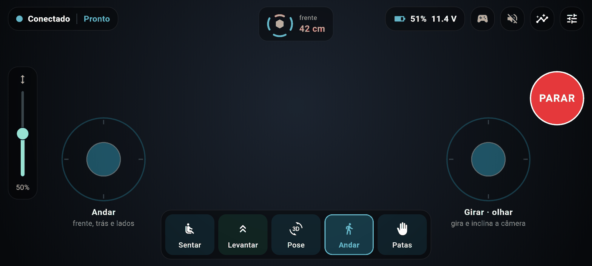</p>

São duas portas de entrada, de propósito:

- **Caminho simples:** gravar uma imagem pronta no cartão SD, ligar o robô e configurar tudo pelo celular: pareamento, Wi-Fi, atualizações. Sem terminal, sem precisar entender de computador.
- **Caminho maker:** tudo continua aberto: SSH no Pi, provisionamento com Ansible, deploy com rollback automático, simulador, métricas e o código de todas as partes.

> **Estado:** em desenvolvimento. O app, o lado do Pi e o firmware rodam numa bancada (Pi 3 + um ESP32 clássico no lugar do ESP32-S3), com GPS e a tela de estado ligados. Servos e a maioria dos sensores estão sendo instalados. Nada aqui mexe um servo sem o piloto pedir.

## Conteúdo

- [Funcionalidades](#funcionalidades)
- [Telas](#telas)
- [Lista de peças](#lista-de-peças)
- [Instalação: caminho simples](#instalação-caminho-simples)
- [Instalação: caminho maker](#instalação-caminho-maker)
- [Como funciona](#como-funciona)
- [Desenvolvimento](#desenvolvimento)
- [Segurança](#segurança)
- [Idiomas](#idiomas) · [Licença](#licença)

## Funcionalidades

**Pilotagem**
- Tela deitada estilo app de drone: dois joysticks na tela, régua de altura do corpo, modos **Sentar / Levantar / Pose / Andar / Patas** (gestos de acenar, guarda e golpe com as patas da frente).
- Suporte ao **controle PS5 DualSense**: analógicos, gatilhos, botões e a cor da luz conforme o estado do robô; com o controle conectado, os joysticks da tela somem.
- Câmera ao vivo (WebRTC), com o áudio do microfone do robô opcional.
- Botão grande de **PARAR**, radar de distância em volta do robô, bateria, qualidade do sinal e avisos em palavras simples dizendo o que fazer.
- Retorno visual no meio da tela (anel do "segure para levantar", cartões dos gestos) e barras que se escondem sozinhas enquanto você pilota.

**Configuração sem computador**
- **Pareamento em segundos:** a tela do robô mostra um QR e um código de 5 letras e números; o app acha o robô (ou entra na rede própria dele) e pareia. Cada robô tem a sua chave: ninguém mais na rede consegue pilotá-lo.
- **Wi-Fi pelo celular:** no primeiro boot o robô abre a rede própria (`Hexapode-XXXX`); para usar a rede de casa, escolha a rede e digite a senha no celular. Com a senha errada, o robô volta sozinho para a rede dele.
- **Vários robôs** no mesmo app ("Meus robôs"), cada um com o seu nome.
- **Imagem pronta do cartão SD**, que grava o ESP32 sozinha no primeiro boot.

**Dados e saúde**
- Tela de dados em abas: resumo, orientação (horizonte artificial), distância, **posição GPS**, ambiente (temperatura, umidade, pressão, **alarme de gás e fumaça**), ângulos das pernas, saúde do ESP32 e **saúde do próprio Raspberry Pi** (CPU, temperatura, memória, cartão, quedas de energia).
- **Tela de estado no robô** (OLED 0,96"): progresso do boot, rede, IP, bateria e o código de pareamento.
- Métricas para o Prometheus em `/metrics`, para quem quiser montar painéis.

**Segurança e atualizações**
- Os servos começam desligados; o homem-morto (comandos a 20 Hz) faz o robô parar, sentar e relaxar sozinho quando o app silencia. O failsafe mora no ESP32 e não pode ser desligado remotamente.
- Proteções de inclinação, obstáculo e bateria baixa no próprio robô.
- Atualizações só instalam com o robô sentado, gravam o ESP32, conferem se a versão nova responde em até 10 s e, se não, voltam a anterior.
- O cartão SD pode rodar em modo somente leitura: tirar a energia não corrompe nada.

**Para todo mundo**
- App em **português do Brasil e inglês** (segue o celular, ou escolha nos Ajustes).

## Telas

Geradas a partir do app com um robô simulado (`cd app && make screenshots`), por isso aparecem todos os sensores instalados. Versões em inglês: [docs/screenshots/en](docs/screenshots/en).

| | |
|---|---|
|  **Abertura** | 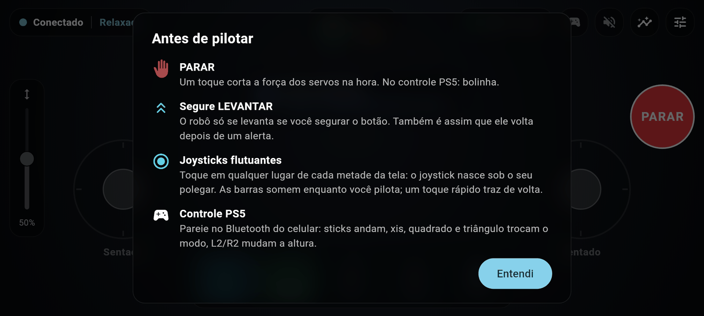 **Dicas do primeiro uso** |
|  **Pilotando** | 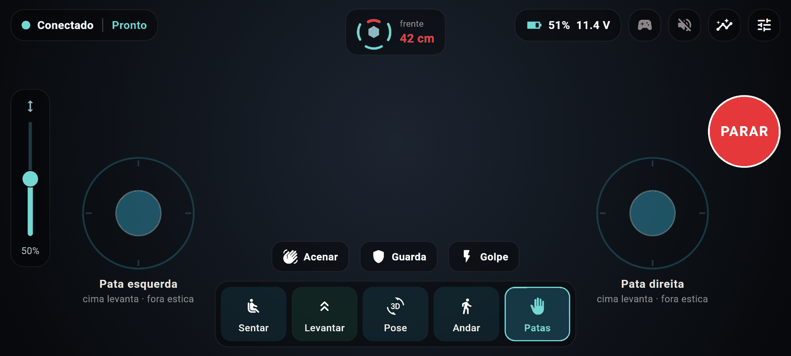 **Patas da frente: gestos** |
| 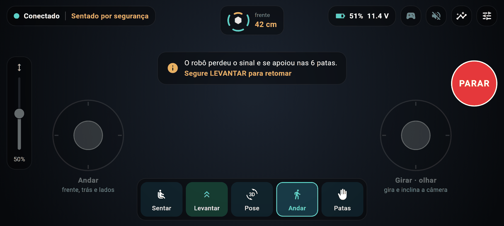 **Failsafe: sentou sozinho** | 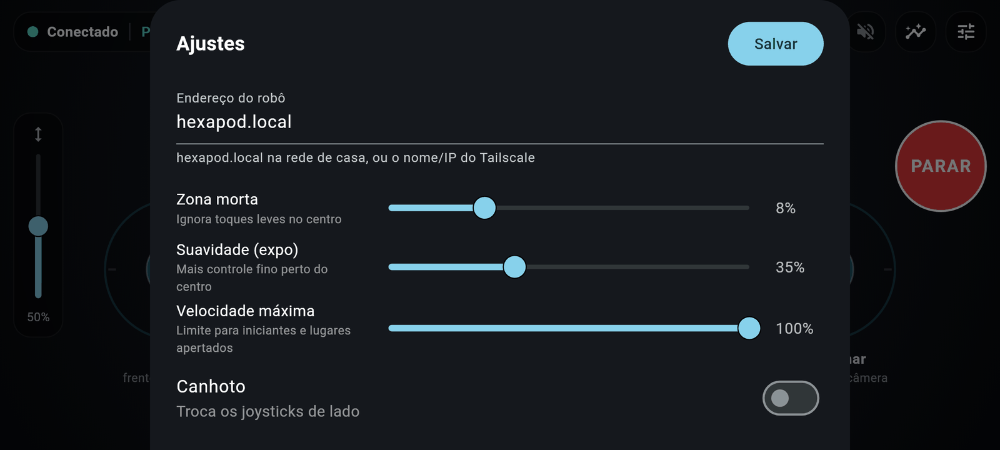 **Ajustes** |
| 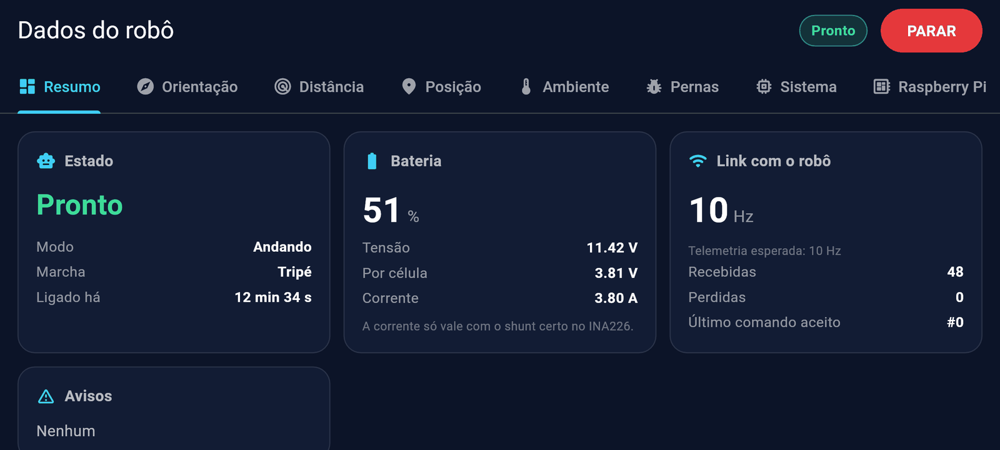 **Dados: resumo** | 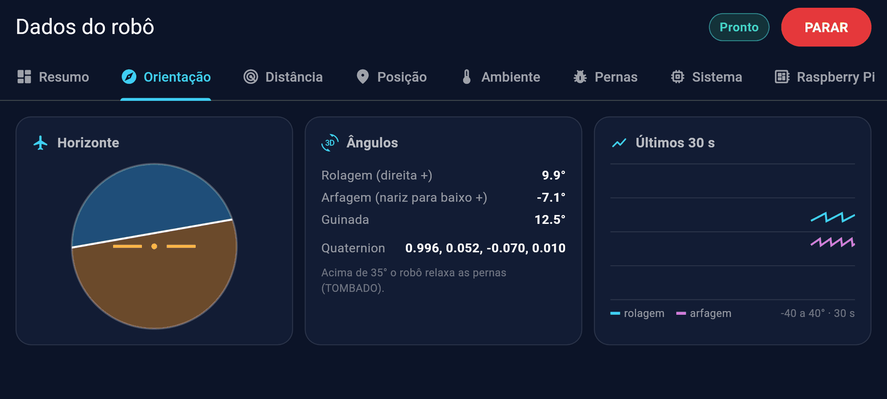 **Dados: orientação** |
| 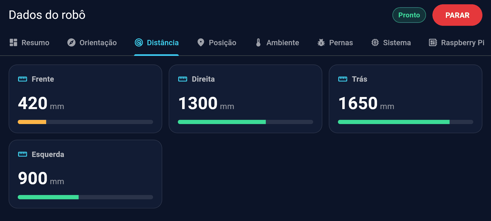 **Dados: radar de distância** | 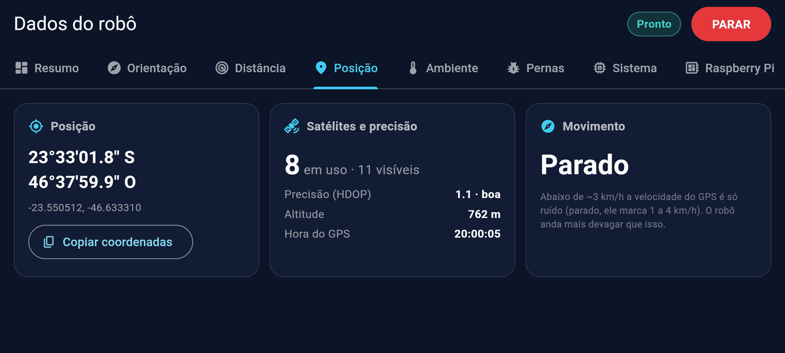 **Dados: GPS** |
| 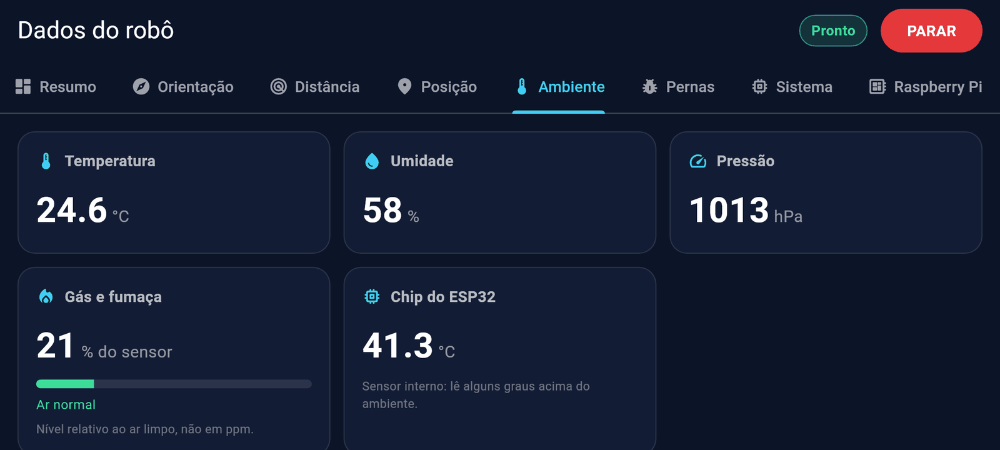 **Dados: ambiente e gás** | 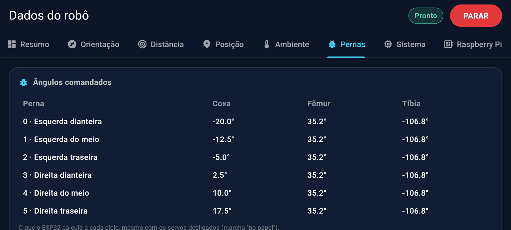 **Dados: ângulos das pernas** |
| 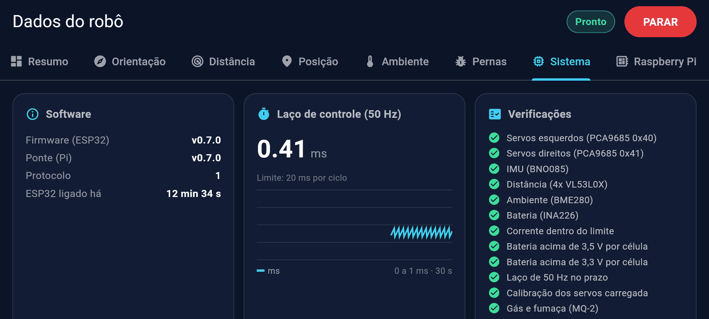 **Dados: ESP32** | 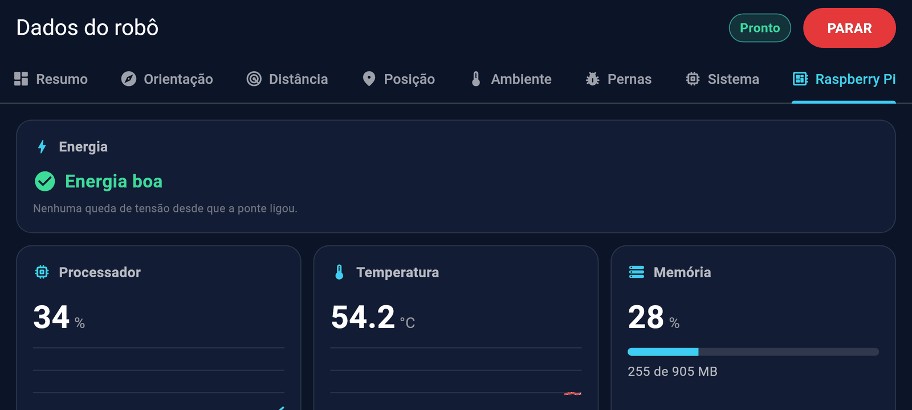 **Dados: saúde do Raspberry Pi** |
| 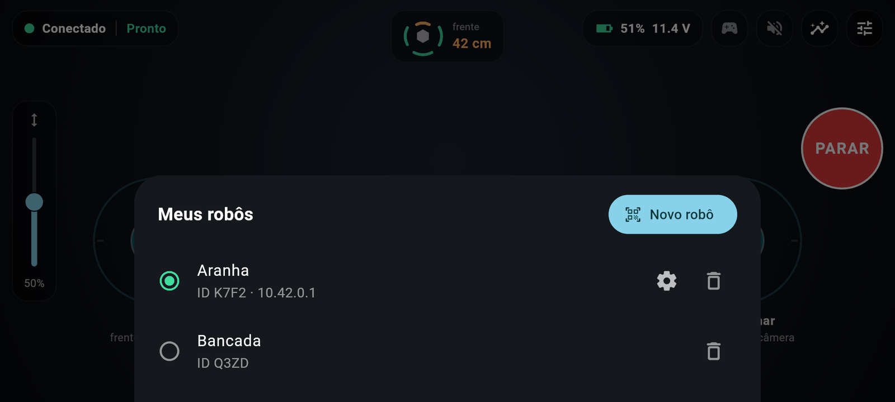 **Meus robôs** | 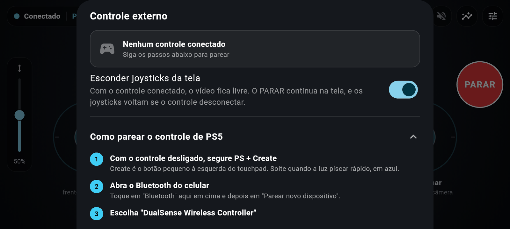 **Controle PS5** |
| 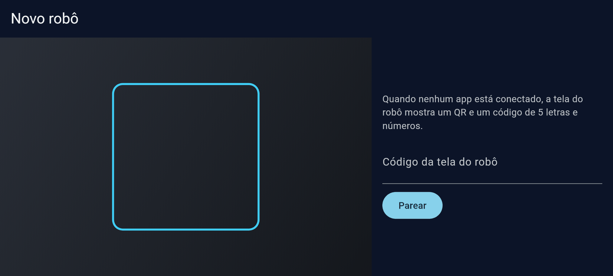 **Pareamento pelo código** |  **No celular de verdade, robô de bancada** |

## Lista de peças

**Mecânica**

| Qtd | Peça | Observação |
|---|---|---|
| 1 jogo | Corpo e pernas impressos em 3D | Baseado no *Hexapod Spider Robot with Servo & Arduino*, de Emre Kalem (MakerWorld), com o corpo adaptado para a eletrônica. Ver [`cad/`](cad/README.md) |
| 18 | Servo MG996R | 3 por perna (coxa, fêmur, tíbia) |
| — | Parafusos, braços dos servos e rolamentos | Como no modelo original |

**Eletrônica**

| Qtd | Peça | Função |
|---|---|---|
| 1 | Raspberry Pi 3 Model B (ou Pi 4) + microSD de 16 GB ou mais | Ponte, vídeo, Wi-Fi, tela de estado, GPS |
| 1 | ESP32-S3 SuperMini | Controle em tempo real e failsafe (USB até o Pi) |
| 2 | Placa PWM PCA9685 de 16 canais (HW-170) | Servos: uma por lado (0x40 e 0x41) |
| 1 | IMU BNO085 | Orientação e detecção de queda |
| 4 | Sensor de distância VL53L0X (GY-VL53L0XV2) | Radar de obstáculos (frente, direita, trás, esquerda) |
| 1 | BME280 | Temperatura, umidade, pressão |
| 1 | INA226 | Tensão e corrente da bateria (**trocar o shunt de 0,1 Ω**, ver abaixo) |
| 1 | Módulo MQ-2 | Gás e fumaça (leitura relativa, alarme informativo) |
| 1 | Câmera OV5647 grande-angular 120° | Vídeo (CSI) |
| 1 | Mini microfone USB | Áudio do robô |
| 1 | GPS GY-NEO6MV2 (u-blox NEO-6M) | Posição (UART do Pi) |
| 1 | OLED SSD1306 0,96" I2C | Tela de estado e código de pareamento |
| — | LEDs WS2812 (opcional) | Luzes de estado (a definir) |

**Energia**

| Qtd | Peça | Observação |
|---|---|---|
| 1 | LiPo 3S 2200 mAh, XT60 | Bateria principal |
| 1 | Fusível de 20 A + chave anti-spark | Logo depois da bateria |
| 1 | Step-down de 20 A, ajustado em 6,0 V | Energia dos servos (V+ das PCA9685) |
| 1 | Mini560 Pro 5 V / 5 A | Lógica: Pi (5 V do GPIO), ESP32, sensores |

Ligações e pinos: [`firmware/PINOUT.md`](firmware/PINOUT.md).

> **Shunt do INA226:** a maioria dos módulos vem com shunt de 0,1 Ω, que só mede até ~0,8 A. O robô puxa vários ampères: use um shunt de 2 mΩ (até ~40 A) ou um externo de 50–75 mV, e ajuste o valor em `firmware/include/config.h`.

## Instalação: caminho simples

Você precisa de: o robô montado, um cartão microSD (16 GB ou mais), um PC com leitor de cartão e um celular Android 10 ou mais novo.

1. **Grave o cartão.** Baixe o `hexapod-<versão>-esp32s3.img.xz` na página de **Releases** do projeto. No **Raspberry Pi Imager**: dispositivo *Raspberry Pi 3* → *Escolher SO* → *Usar personalizado* → o arquivo baixado → o seu cartão → *Gravar*. Não precisa descompactar nem personalizar nada.
2. **Ligue o robô.** A telinha mostra *HEXAPOD · INICIANDO* e vai marcando sistema, rede, ESP32 e ponte. **O primeiro boot leva uns 2 minutos**: o robô ajusta o cartão e grava o ESP32 sozinho. Não desligue nessa hora.
3. **Instale o app** (em breve na Google Play; por enquanto o APK da página de Releases).
4. **Pareie.** Abra o app → **Parear um robô** → aponte a câmera para o QR da tela do robô, ou digite o código de 5 que aparece ao lado. Se o Android perguntar se quer entrar na rede **Hexapode-…**, toque em **Conectar**. Pronto: **Pareado!**
5. **Wi-Fi de casa (opcional).** *Ajustes → Rede do robô (Wi-Fi) → Conectar a uma rede*, escolha a sua e digite a senha (redes 2,4 GHz no Pi 3). Ela fica gravada só no robô. Sem isso, o robô continua na rede própria, que funciona em qualquer lugar, até no quintal sem roteador.

| Problema | O que fazer |
|---|---|
| A telinha fica apagada ou pisca | Quase sempre é energia: na bancada, use a fonte oficial do Pi (5,1 V / 2,5 A); carregador de celular não serve |
| O app não acha o robô | Celular e robô precisam estar na mesma rede, ou digite o IP que aparece na tela do robô |
| "Código errado ou vencido" | Use o código que está na tela **agora**: ele muda a cada 10 minutos e a cada uso |
| A rede **Hexapode-…** não aparece | O Wi-Fi do Pi não ligou: confira a energia e espere um minuto depois de ligar |
| A tela mostra **ESP32 sem resposta** | Confira o cabo USB entre o Pi e o ESP32 |

Guia completo: [`docs/instalar.md`](docs/instalar.md).

## Instalação: caminho maker

Tudo o que o caminho simples faz, na mão e sob o seu controle.

**1. Prepare o Pi** a partir do Raspberry Pi OS Lite 64-bit (hostname `hexapod`, seu usuário e chave SSH) e provisione com Ansible a partir do PC:

```bash
cd pi/provision
ansible-playbook site.yml --check --diff   # simulação
ansible-playbook site.yml                  # câmera, MediaMTX, serviço hexd, udev, I2C/UART, watchdog...
ssh wallace@hexapod.local 'bash -s' < check.sh   # validação
```

Detalhes, o cartão somente leitura e o Tailscale: [`pi/provision/README.md`](pi/provision/README.md).

**2. Gere e instale uma versão** (hexd + firmware do ESP32, num pacote só):

```bash
BOARD=esp32s3 pi/deploy/package.sh                  # dist/hexapod-<versão>.tar.gz
scp dist/hexapod-<versão>.tar.gz wallace@hexapod.local:/tmp/
ssh wallace@hexapod.local
cd /tmp && tar -xzf hexapod-<versão>.tar.gz --wildcards '*/deploy.sh' --strip-components=1
sudo bash ./deploy.sh /tmp/hexapod-<versão>.tar.gz  # recusa se o robô não estiver sentado
```

O deploy grava o ESP32, reinicia o `hexd`, confere se as duas versões respondem em até 10 s e, se não, volta a anterior. Guarda as últimas 5 versões.

**3. Pareie pelo terminal:** `sudo -u hexapod /opt/hexapod/current/bin/hexd -pairing` mostra a chave e um QR (`HXP1 <id> <chave>`), que o app também aceita.

**4. Olhe por dentro:**
- `http://hexapod.local:8080/metrics` (Prometheus): bateria, estado, distâncias, tempo do laço, temperaturas, sinal do Wi-Fi, CPU/memória/cartão/energia do Pi.
- `/health`, `/version`, `journalctl -u hexd -f`.
- Vídeo: `http://hexapod.local:8889/cam` no navegador (MediaMTX, WebRTC).

**5. Gere a imagem do cartão você mesmo:** `sudo pi/image/build-image.sh dist/hexapod-<versão>.tar.gz dist/image` (numa máquina ARM, ou x86 com `qemu-user-binfmt`). A mesma imagem é gerada pela esteira a cada tag `v*`.

## Como funciona

```
App Android ──WebSocket (Protobuf)──► Raspberry Pi (hexd, MediaMTX, OLED, GPS)
     ▲                                     │ USB (COBS + CRC16 + nanopb)
     └──── vídeo e áudio WebRTC ───────────┤
                                           ▼
                                      ESP32-S3 (movimento a 50 Hz, failsafe)
                                           │ I2C / ADC
                               ┌───────────┴───────────┐
                         2x PCA9685 (18 servos)  Sensores (BNO085, 4x VL53L0X,
                                                  BME280, INA226, MQ-2)
```

- **ESP32-S3:** laço de movimento a 50 Hz (marcha tripé, cinemática inversa de 3 graus de liberdade, limites por junta gravados na NVS), sensores e o failsafe (parar → sentar com segurança → relaxar quando os comandos param de chegar).
- **Raspberry Pi:** `hexd`, serviço em Go: link serial com reconexão automática, WebSocket para o app, repasse com homem-morto, pareamento, Wi-Fi (NetworkManager), tela de estado, GPS, métricas, desligamento seguro com bateria crítica. O MediaMTX transmite a câmera e o microfone.
- **App:** Flutter (Riverpod), envia comandos a 20 Hz mesmo com os joysticks parados.
- **Um contrato só:** cada mensagem é definida uma vez em [`proto/`](proto/README.md) e gerada para Go, C (nanopb) e Dart.

## Desenvolvimento

Requisitos: Go 1.25+, Flutter 3.41+, PlatformIO, `buf` com `protoc-gen-go` e nanopb, Ansible (para o Pi).

| Parte | Teste | O que cobre |
|---|---|---|
| Firmware | `cd firmware && pio test -e native` | IK, marcha, failsafe, link COBS/CRC |
| Pi | `cd pi && go test ./...` | Unidades do `hexd` + integração com o `hexsim` |
| App | `cd app && make test` | Unidade, widgets e integração contra `hexd` + `hexsim` de verdade |

Sem robô: o [`hexsim`](pi/hexsim) fala o protocolo do ESP32, então a cadeia inteira (app → hexd → "ESP32") roda num PC. Comandos do app: `cd app && make help` (`make run`, `make install` no celular pelo cabo USB, `make screenshots`). Mais em [`app/README.md`](app/README.md).

| Pasta | Conteúdo |
|---|---|
| `proto/` | O contrato Protobuf |
| `firmware/` | Firmware do ESP32 (PlatformIO, Arduino + FreeRTOS) |
| `pi/hexd/`, `pi/hexsim/` | Serviço ponte e simulador do ESP32 (Go) |
| `pi/provision/`, `pi/systemd/`, `pi/mediamtx/` | Preparação do Pi, serviços, streaming |
| `pi/deploy/`, `pi/image/` | Pacote de versão, deploy com rollback, gerador da imagem do cartão |
| `app/` | App Flutter |
| `cad/` | STLs e medidas |
| `docs/` | Guias e telas |

**Convenções:** código, comentários e commits em inglês ([Conventional Commits](https://www.conventionalcommits.org/)). Uma versão para tudo: a tag do git (`vMAIOR.MENOR.CORREÇÃO`) vai para o `hexd`, o firmware, o app e o nome da imagem. Constantes físicas ficam num lugar só (`firmware/include/config.h`, `hexd.yaml`), com a unidade.

## Segurança

É um robô de ~2,5 kg com 18 servos fortes e bateria de lítio.

- O firmware liga com os **servos desligados** (OE das PCA9685 em alto) e só dá força a eles quando o piloto manda levantar.
- Calibre com o robô **fora do chão**, um servo por vez, antes de levantar pela primeira vez.
- Fique com a mão perto do **PARAR** nas primeiras vezes em que ele levantar e andar.
- Use o fusível, um carregador de LiPo adequado e nunca deixe carregando sem ninguém olhando.
- O alarme de gás é informativo: o MQ-2 não é um detector certificado.

## Idiomas

O app fala português do Brasil e inglês. Para incluir um idioma, basta um arquivo: copie `app/lib/l10n/app_en.arb` para `app_<código>.arb` e traduza os valores. Contribuições são bem-vindas.

## Licença

A definir antes do lançamento público.
