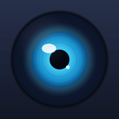
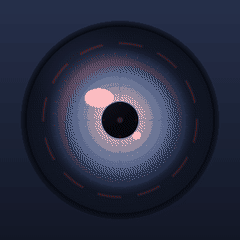
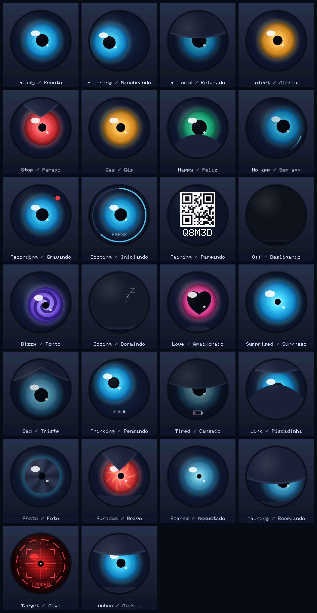
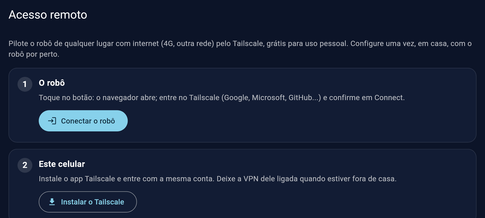
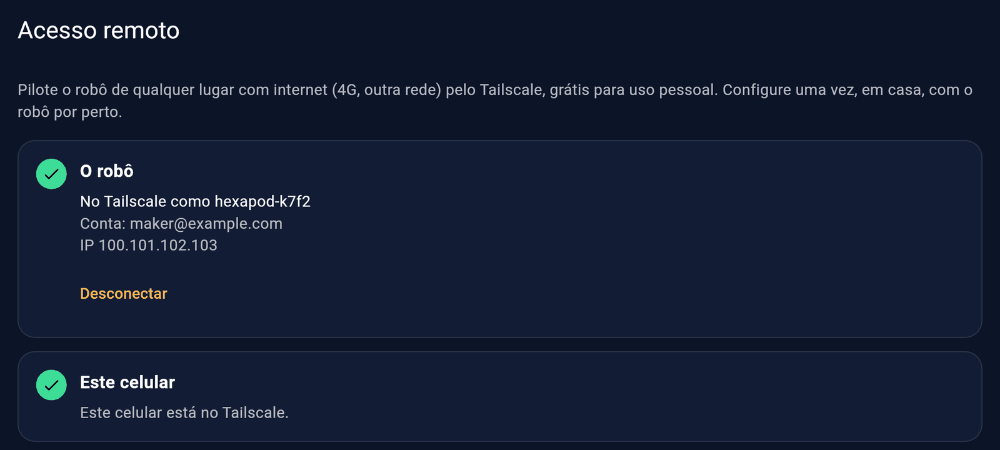
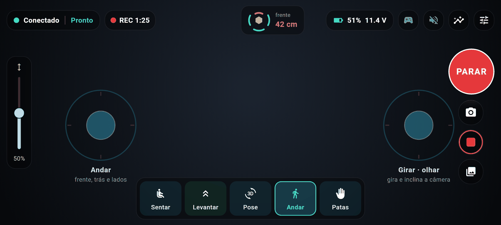
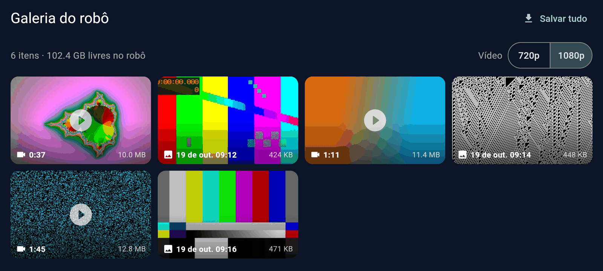

# Hexápode aranha

[English](README.md) · **Português**

Robô de seis patas impresso em 3D, com 18 servos, pilotado pelo celular Android via Wi-Fi. Um ESP32 cuida do controle em tempo real e do failsafe de segurança; um Raspberry Pi faz a ponte com o app, transmite a câmera e mostra o estado numa telinha.

<p align="center"></p>

São duas portas de entrada, de propósito:

- **Caminho simples:** gravar uma imagem pronta no cartão SD, ligar o robô e configurar tudo pelo celular: pareamento, Wi-Fi, atualizações. Sem terminal, sem precisar entender de computador.
- **Caminho maker:** tudo continua aberto: SSH no Pi, provisionamento com Ansible, deploy com rollback automático, simulador, métricas e o código de todas as partes.

> **Estado:** em desenvolvimento. O app, o lado do Pi e o firmware rodam numa bancada (Pi 3 + um ESP32 clássico no lugar do ESP32-S3), com GPS e a tela de estado ligados. Servos e a maioria dos sensores estão sendo instalados. Nada aqui mexe um servo sem o piloto pedir.

## Conteúdo

- [Funcionalidades](#funcionalidades)
- [Telas](#telas)
- [Lista de peças](#lista-de-peças) · [Ligações (pinagem)](firmware/PINOUT.pt-BR.md)
- [Instalação: caminho simples](#instalação-caminho-simples)
- [Instalação: caminho maker](#instalação-caminho-maker)
- [Arquitetura](#arquitetura)
- [Desenvolvimento](#desenvolvimento)
- [Segurança](#segurança)
- [Idiomas](#idiomas) · [Créditos](#créditos) · [Licença](#licença)

## Funcionalidades

**Pilotagem**
- Tela deitada estilo app de drone: dois joysticks na tela, régua de altura do corpo, modos **Sentar / Levantar / Pose / Andar / Patas** (gestos de acenar, guarda e golpe com as patas da frente).
- Suporte ao **controle PS5 DualSense**: analógicos, gatilhos, botões e a cor da luz conforme o estado do robô; com o controle conectado, os joysticks da tela somem.
- Câmera ao vivo (WebRTC), com o áudio do microfone do robô opcional, em 720p ou 1080p.
- **Fotos e gravações** com um toque, guardadas no cartão do robô (sem recodificar, o Pi quase nem sente), e uma **galeria** no app que salva tudo na galeria do celular pelo Wi-Fi ou pelo Tailscale.
- Botão grande de **PARAR**, radar de distância em volta do robô, bateria, qualidade do sinal e avisos em palavras simples dizendo o que fazer.
- Retorno visual no meio da tela (anel do "segure para levantar", cartões dos gestos) e barras que se escondem sozinhas enquanto você pilota.

**Configuração sem computador**
- **Pareamento em segundos:** a tela do robô mostra um QR e um código de 5 letras e números; o app acha o robô (ou entra na rede própria dele) e pareia. Cada robô tem a sua chave: ninguém mais na rede consegue pilotá-lo.
- **Wi-Fi pelo celular:** no primeiro boot o robô abre a rede própria (`Hexapode-XXXX`); para usar a rede de casa, escolha a rede e digite a senha no celular. Com a senha errada, o robô volta sozinho para a rede dele.
- **Acesso remoto pelo app:** pilote de qualquer lugar (4G, outra rede) pelo Tailscale, configurado com um login no navegador: [passo a passo](docs/acesso-remoto.md).
- **Vários robôs** no mesmo app ("Meus robôs"), cada um com o seu nome.
- **Imagem pronta do cartão SD**, que grava o ESP32 sozinha no primeiro boot.

**Dados e saúde**
- Tela de dados em abas: resumo, orientação (horizonte artificial), distância, **posição GPS**, ambiente (temperatura, umidade, pressão, **alarme de gás e fumaça**), ângulos das pernas, saúde do ESP32 e **saúde do próprio Raspberry Pi** (CPU, temperatura, memória, cartão, quedas de energia).
- **Um olho de ciclope:** uma tela colorida de 1,54" atrás de uma janela redonda na "cara" do robô, com a câmera como "nariz" e um farol de cada lado. Mostra expressões, o progresso do boot e o código de pareamento. *(O software do olho está pronto e espera a tela; até lá, uma OLED de 0,96" dentro do corpo mostra o estado e o código de pareamento.)*
- Métricas para o Prometheus em `/metrics`, para quem quiser montar painéis.

**Segurança e atualizações**
- Os servos começam desligados; o homem-morto (comandos a 20 Hz) faz o robô parar, sentar e relaxar sozinho quando o app silencia. O failsafe mora no ESP32 e não pode ser desligado remotamente.
- Proteções de inclinação, obstáculo e bateria baixa no próprio robô.
- Atualizações só instalam com o robô sentado, gravam o ESP32, conferem se a versão nova responde em até 10 s e, se não, voltam a anterior.
- O cartão SD pode rodar em modo somente leitura: tirar a energia não corrompe nada.

**Para todo mundo**
- App em **português do Brasil e inglês** (segue o celular, ou escolha nos Ajustes).

## Telas

Geradas a partir do app com um robô simulado (`cd app && make screenshots`), por isso aparecem todos os sensores instalados. Versões em inglês: [docs/screenshots/en](docs/screenshots/en).

**O olho de ciclope** (26 expressões, cada uma em imagem e vídeo em [docs/eye](docs/eye)):

<p align="center">  </p>
<p align="center"></p>

| | |
|---|---|
|  **Abertura** |  **Dicas do primeiro uso** |
|  **Pilotando** |  **Patas da frente: gestos** |
|  **Failsafe: sentou sozinho** |  **Ajustes** |
|  **Dados: resumo** |  **Dados: orientação** |
|  **Dados: radar de distância** |  **Dados: GPS** |
|  **Dados: ambiente e gás** |  **Dados: ângulos das pernas** |
|  **Dados: ESP32** |  **Dados: saúde do Raspberry Pi** |
|  **Acesso remoto: configurar** |  **Acesso remoto: pronto** |
|  **Gravando (REC), com os botões de foto e gravar** |  **Galeria do robô: salvar no celular** |
|  **Meus robôs** |  **Controle PS5** |
|  **Pareamento pelo código** |  **No celular de verdade, robô de bancada** |

## Lista de peças

**Mecânica**

| Qtd | Peça | Observação |
|---|---|---|
| 1 jogo | Corpo e pernas impressos em 3D | Do projeto [*Hexapod Spider Robot with Servo & Arduino*](https://makerworld.com/pt/models/1973965-hexapod-spider-robot-with-servo-arduino), de Emre Kalem (MakerWorld), com o corpo adaptado para a eletrônica. Ver [`cad/`](cad/README.md) |
| 18 | Servo MG996R | 3 por perna (coxa, fêmur, tíbia), com os braços |
| 90 | Parafuso M3 × 6 mm | |
| 90 | Parafuso M3 × 10 mm | |
| 18 | Rolamento 695 (5 × 13 × 4 mm) | Um por junta |

> **As nossas peças são modificadas.** O corpo está sendo refeito para receber a eletrônica e os sensores deste projeto (Raspberry Pi, ESP32, câmera, os 4 sensores de distância, IMU, tela, GPS). Esses STLs ainda não foram publicados; vão para [`cad/`](cad/README.md). Até lá, o modelo original imprime e monta, mas a eletrônica precisa de suportes seus.

**Eletrônica**

| Qtd | Peça | Função |
|---|---|---|
| 1 | Raspberry Pi 3 Model B ou Pi 4 (ver [Pi 3 ou Pi 4](#raspberry-pi-3-ou-pi-4)) + microSD de 16 GB ou mais | Ponte, vídeo, Wi-Fi, tela de estado, GPS |
| 1 | ESP32-S3 SuperMini | Controle em tempo real e failsafe (USB até o Pi) |
| 2 | Placa PWM PCA9685 de 16 canais (HW-170) | Servos: uma por lado (0x40 e 0x41) |
| 1 | IMU BNO085 | Orientação e detecção de queda |
| 4 | Sensor de distância VL53L0X (GY-VL53L0XV2) | Radar de obstáculos (frente, direita, trás, esquerda) |
| 1 | BME280 | Temperatura, umidade, pressão |
| 1 | INA226 | Tensão e corrente da bateria (**trocar o shunt de 0,1 Ω**, ver abaixo) |
| 1 | Módulo MQ-2 | Gás e fumaça (leitura relativa, alarme informativo) |
| 1 | Câmera OV5647 grande-angular 120° | Vídeo (CSI) |
| 1 | Mini microfone USB | Áudio do robô |
| 1 | GPS GY-NEO6MV2 (u-blox NEO-6M) | Posição (UART do Pi) |
| 1 | Tela colorida ST7789 1,54", SPI (240×240) | O olho de ciclope, atrás de uma janela redonda de 27 mm; também mostra o código de pareamento |
| 2 | LEDs WS2812 | Faróis, um de cada lado da câmera |
| (1) | OLED SSD1306 0,96" I2C | Tela de estado até o olho ficar pronto (depois não precisa) |

**Energia**

| Qtd | Peça | Observação |
|---|---|---|
| 1 | LiPo 3S 2200 mAh, XT60 | Bateria principal |
| 1 | Fusível de 20 A + chave anti-spark | Logo depois da bateria |
| 1 | Step-down de 20 A, ajustado em 6,0 V | Energia dos servos (V+ das PCA9685) |
| 1 | Mini560 Pro 5 V / 5 A | Lógica: Pi (5 V do GPIO), ESP32, sensores |

**Ligações:** cada pino das duas placas ESP32, o GPS e a tela no Pi, o divisor do MQ-2, os canais dos servos, os endereços I2C e a alimentação estão na **[pinagem (`firmware/PINOUT.pt-BR.md`)](firmware/PINOUT.pt-BR.md)**.

### Raspberry Pi 3 ou Pi 4

A mesma imagem do cartão e o mesmo código rodam nos dois, sem configurar nada: o robô descobre sozinho em qual placa está.

| | Pi 3 Model B | Pi 4 Model B |
|---|---|---|
| Fonte (bancada) | 5,1 V / 2,5 A | 5,1 V / **3 A** (USB-C) |
| Rede própria do robô | 2,4 GHz | **5 GHz** (canal 36), vídeo mais estável; volta sozinha para 2,4 GHz se precisar |
| Redes de casa que ele alcança | 2,4 GHz | 2,4 e 5 GHz (o app mostra a faixa de cada uma) |
| Memória | 1 GB | 1 a 8 GB: espaço para funções futuras (ex.: visão) |
| Calor | Baixo | Maior: use dissipador (o app mostra a temperatura, Dados → Raspberry Pi) |
| Câmera, codificador de vídeo, GPS, tela, ligações | Iguais | Iguais |

O Pi 5 ainda não é suportado: ele não tem codificador H.264 por hardware e usa outro conector de câmera.

> **Shunt do INA226:** a maioria dos módulos vem com shunt de 0,1 Ω, que só mede até ~0,8 A. O robô puxa vários ampères: use um shunt de 2 mΩ (até ~40 A) ou um externo de 50–75 mV, e ajuste o valor em `firmware/include/config.h`.

## Instalação: caminho simples

Você precisa de: o robô montado, um cartão microSD (16 GB ou mais), um PC com leitor de cartão e um celular Android 10 ou mais novo.

1. **Grave o cartão.** Baixe o `hexapod-<versão>-esp32s3.img.xz` na página de **Releases** do projeto. No **Raspberry Pi Imager**: dispositivo *Raspberry Pi 3* ou *4* (a mesma imagem roda nos dois) → *Escolher SO* → *Usar personalizado* → o arquivo baixado → o seu cartão → *Gravar*. Não precisa descompactar nem personalizar nada.
2. **Ligue o robô.** A telinha mostra *HEXAPOD · INICIANDO* e vai marcando sistema, rede, ESP32 e ponte. **O primeiro boot leva uns 2 minutos**: o robô ajusta o cartão e grava o ESP32 sozinho. Não desligue nessa hora.
3. **Instale o app** (em breve na Google Play; por enquanto o APK da página de Releases).
4. **Pareie.** Abra o app → **Parear um robô** → aponte a câmera para o QR da tela do robô, ou digite o código de 5 que aparece ao lado. Se o Android perguntar se quer entrar na rede **Hexapode-…**, toque em **Conectar**. Pronto: **Pareado!**
5. **Wi-Fi de casa (opcional).** *Ajustes → Rede do robô (Wi-Fi) → Conectar a uma rede*, escolha a sua e digite a senha (o Pi 3 só enxerga redes 2,4 GHz; o Pi 4 também 5 GHz). Ela fica gravada só no robô. Sem isso, o robô continua na rede própria, que funciona em qualquer lugar, até no quintal sem roteador.

| Problema | O que fazer |
|---|---|
| A telinha fica apagada ou pisca | Quase sempre é energia: na bancada, use a fonte oficial do Pi (5,1 V / 2,5 A no Pi 3, 5,1 V / 3 A no Pi 4); carregador de celular não serve |
| O app não acha o robô | Celular e robô precisam estar na mesma rede, ou digite o IP que aparece na tela do robô |
| "Código errado ou vencido" | Use o código que está na tela **agora**: ele muda a cada 10 minutos e a cada uso |
| A rede **Hexapode-…** não aparece | O Wi-Fi do Pi não ligou: confira a energia e espere um minuto depois de ligar |
| A tela mostra **ESP32 sem resposta** | Confira o cabo USB entre o Pi e o ESP32 |

Guia completo: [`docs/instalar.md`](docs/instalar.md). Acesso remoto (pilotar fora de casa): [`docs/acesso-remoto.md`](docs/acesso-remoto.md).

## Instalação: caminho maker

Tudo o que o caminho simples faz, na mão e sob o seu controle. **Guia completo: [`docs/instalacao-maker.md`](docs/instalacao-maker.md)**; a versão curta:

**1. Prepare o Pi** a partir do Raspberry Pi OS Lite 64-bit (hostname `hexapod`, usuário `hexasys` e a sua chave SSH: [como criar](docs/chave-ssh.md)) e provisione com Ansible a partir do PC:

```bash
cd pi/provision
ansible-playbook site.yml --check --diff   # simulação
ansible-playbook site.yml                  # câmera, MediaMTX, serviço hexd, udev, I2C/UART, watchdog...
ssh hexasys@hexapod.local 'bash -s' < check.sh   # validação
```

Detalhes, o cartão somente leitura e o Tailscale: [`pi/provision/README.pt-BR.md`](pi/provision/README.pt-BR.md).

**2. Gere e instale uma versão** (hexd + firmware do ESP32, num pacote só):

```bash
BOARD=esp32s3 pi/deploy/package.sh                  # dist/hexapod-<versão>.tar.gz
scp dist/hexapod-<versão>.tar.gz hexasys@hexapod.local:/tmp/
ssh hexasys@hexapod.local
cd /tmp && tar -xzf hexapod-<versão>.tar.gz --wildcards '*/deploy.sh' --strip-components=1
sudo bash ./deploy.sh /tmp/hexapod-<versão>.tar.gz  # recusa se o robô não estiver sentado
```

O deploy grava o ESP32, reinicia o `hexd`, confere se as duas versões respondem em até 10 s e, se não, volta a anterior. Guarda as últimas 5 versões.

**3. Pareie pelo terminal:** `sudo -u hexapod /opt/hexapod/current/bin/hexd -pairing` mostra a chave e um QR (`HXP1 <id> <chave>`), que o app também aceita.

**4. Olhe por dentro:**
- `http://hexapod.local:8080/metrics` (Prometheus): bateria, estado, distâncias, tempo do laço, temperaturas, sinal do Wi-Fi, CPU/memória/cartão/energia do Pi.
- `/health`, `/version`, `journalctl -u hexd -f`.
- Vídeo: `http://hexapod.local:8889/cam` no navegador (MediaMTX, WebRTC).

**5. Gere a imagem do cartão você mesmo:** `sudo pi/image/build-image.sh dist/hexapod-<versão>.tar.gz dist/image` (numa máquina ARM, ou x86 com `qemu-user-binfmt`). A mesma imagem é gerada pela esteira a cada tag `v*`.

## Arquitetura

```
App Android ──WebSocket (Protobuf)──► Raspberry Pi (hexd, MediaMTX, olho, GPS)
     ▲                                     │ USB (COBS + CRC16 + nanopb)
     └──── vídeo e áudio WebRTC ───────────┤
                                           ▼
                                      ESP32-S3 (movimento a 50 Hz, failsafe)
                                           │ I2C / ADC
                               ┌───────────┴───────────┐
                         2x PCA9685 (18 servos)  Sensores (BNO085, 4x VL53L0X,
                                                  BME280, INA226, MQ-2)
```

### Dois cérebros, de propósito

Um robô que anda precisa de duas coisas bem diferentes: **tempo real de verdade** (pulso dos servos a cada 20 ms, uma parada que nunca espera) e **um computador completo** (câmera, Wi-Fi, rede, atualizações). Uma placa só fazendo as duas deixaria uma gravação lenta no cartão, um soluço do driver de Wi-Fi ou um reboot congelar as patas no meio do passo. Então o trabalho é dividido, e **o robô continua seguro mesmo se o Pi travar**: o ESP32 percebe o silêncio e senta sozinho.

| ESP32-S3: o corpo (tempo real) | Raspberry Pi: o cérebro (Linux) | App: o piloto |
|---|---|---|
| Laço de movimento a 50 Hz: marcha tripé, cinemática inversa de 3 graus de liberdade, pose do corpo | `hexd`: ponte entre o app e o ESP32 (serial com reconexão automática, WebSocket, sequência dos comandos) | Pilotagem: joysticks, controle PS5, modos, gestos |
| Saída dos servos pelas 2× PCA9685, limites e calibração por junta gravados na NVS | Homem-morto: app mudo por 150 ms → comando de velocidade zero | Comandos a 20 Hz, mesmo com os joysticks parados |
| Corte de emergência (OE das PCA9685) | Pareamento e chaves; Wi-Fi (rede própria, rede de casa); login do Tailscale | Vídeo e áudio ao vivo |
| **Failsafe** (máquina de estados): parar → sentar com segurança → relaxar quando os comandos param; proteção de inclinação, obstáculo e bateria baixa | Vídeo e áudio: MediaMTX, H.264 pelo codificador de hardware do Pi, WebRTC | Telemetria, telas de dados, avisos em palavras simples |
| Sensores: IMU, 4 de distância, ambiente, bateria, gás | O olho (tela de estado), GPS, saúde do Pi, métricas Prometheus | Configuração de pareamento, Wi-Fi e acesso remoto |
| Watchdog de tarefas: uma tarefa travada reinicia o chip, que liga com os servos desligados | Desligamento seguro com bateria crítica; atualizações com gravação do ESP32 e rollback; cartão somente leitura | Vários robôs, dois idiomas |

**O ESP32 nunca confia no Pi para a segurança:** um comando só vale com o CRC certo e o número de sequência crescente, e o failsafe não pode ser desligado remotamente. A recuperação nunca é automática: o piloto precisa segurar LEVANTAR.

### Por que Go no Pi

O `hexd` é escrito em Go porque a ponte precisa ser confiável numa placa pequena e fácil de instalar para qualquer um:

- **Um binário estático só**, compilado para arm64 a partir de qualquer PC em segundos. Nada para instalar no Pi (nem interpretador, nem pacotes): atualizar é copiar um arquivo e trocar um link, e o rollback é trocar de volta.
- **Leve no Pi 3** (1 GB de RAM, dividido com a codificação do vídeo): liga em milissegundos e ocupa pouco.
- **Concorrência sob medida:** a serial, o WebSocket de cada app, o temporizador do homem-morto, o GPS, a tela de estado e o gerenciador de Wi-Fi rodam cada um na sua goroutine, sem um emaranhado de callbacks.
- **Pilhas incluídas:** HTTP, JSON e testes na biblioteca padrão, Protobuf de primeira, e um detector de condições de corrida que roda na esteira.
- **Fácil de ler:** uma linguagem pequena que quem chega consegue acompanhar e contribuir.

Tempo real não é trabalho do Go aqui (o coletor de lixo pode pausar por um instante), e tudo bem: tudo o que é crítico no tempo mora no ESP32. Também avaliamos Python (o mais fácil de ler, mas mais lento, pesado no Pi 3 e difícil de entregar num arquivo só) e Rust (ótimo, mas uma subida mais íngreme para uma comunidade maker).

### As outras escolhas

- **Protobuf, um contrato só:** cada mensagem é definida uma vez em [`proto/`](proto/README.md) e gerada para Go, C (nanopb, sem memória dinâmica no ESP32) e Dart, então os três lados não se desencontram.
- **COBS + CRC16 na serial USB:** quadros que sobrevivem a ruído e se ressincronizam depois de um corte; quadro corrompido é descartado, nunca executado.
- **Flutter no app:** um código só, fluido o bastante para vídeo com sobreposições, Android hoje e iOS possível depois.
- **Ansible para preparar o Pi:** o Pi não é configurado na mão. Um playbook em [`pi/provision`](pi/provision/README.pt-BR.md) descreve como ele deve ficar (pacotes, ajustes de boot, I2C/SPI/UART, o usuário de serviço e suas permissões mínimas, serviços, watchdog, o cartão somente leitura) e o Ansible, do seu PC pelo SSH, muda só o que estiver diferente. O mesmo playbook gera a imagem pronta do cartão, então todo robô, gravado ou provisionado, roda o mesmo sistema.
- **MediaMTX + WebRTC:** vídeo com pouco atraso direto do codificador H.264 de hardware do Pi, que toca no app e em qualquer navegador.

## Roadmap

Tempo real e segurança continuam no ESP32; estas são funções de "cérebro", a maioria possível graças ao Raspberry Pi 4 (8 GB):

1. **Câmera:** fotos e gravações guardadas no robô, galeria no app e download para a galeria do celular; 720p ou 1080p. *(pronto)*
2. **Siga-me:** seguir um marcador ArUco, depois uma pessoa (com um acelerador Coral USB opcional).
3. **Comandos de voz offline** em português e inglês ("senta", "levanta", "acena"), com palavra de ativação.
4. **Navegação por GPS:** ir até um ponto do mapa, voltar para casa, patrulha e cerca virtual. *(pronto no simulador: [navegação por GPS](docs/navegacao-gps.md))*
5. **Caixa-preta:** telemetria gravada no robô e replay no app; Grafana no robô.
6. **Ponte ROS 2** para RViz, bags e Nav2.
7. **O olho de ciclope** (ST7789 no Pi): expressões por estado, olhar para onde você manobra, o QR de pareamento; substitui a OLED.

## Desenvolvimento

Requisitos: Go 1.25+, Flutter 3.41+, PlatformIO, `buf` com `protoc-gen-go` e nanopb, Ansible (para o Pi).

| Parte | Teste | O que cobre |
|---|---|---|
| Firmware | `cd firmware && pio test -e native` | IK, marcha, failsafe, link COBS/CRC |
| Pi | `cd pi && go test ./...` | Unidades do `hexd` + integração com o `hexsim` |
| App | `cd app && make test` | Unidade, widgets e integração contra `hexd` + `hexsim` de verdade |

Sem robô: o [`hexsim`](pi/hexsim) fala o protocolo do ESP32, então a cadeia inteira (app → hexd → "ESP32") roda num PC. Comandos do app: `cd app && make help` (`make run`, `make install` no celular pelo cabo USB, `make screenshots`). Mais em [`app/README.md`](app/README.md).

| Pasta | Conteúdo |
|---|---|
| `proto/` | O contrato Protobuf |
| `firmware/` | Firmware do ESP32 (PlatformIO, Arduino + FreeRTOS) |
| `pi/hexd/`, `pi/hexsim/` | Serviço ponte e simulador do ESP32 (Go) |
| `pi/provision/`, `pi/systemd/`, `pi/mediamtx/` | Preparação do Pi, serviços, streaming |
| `pi/deploy/`, `pi/image/` | Pacote de versão, deploy com rollback, gerador da imagem do cartão |
| `app/` | App Flutter |
| `cad/` | STLs e medidas |
| `docs/` | Guias e telas |

**Convenções:** código, comentários e commits em inglês ([Conventional Commits](https://www.conventionalcommits.org/)). Uma versão para tudo: a tag do git (`vMAIOR.MENOR.CORREÇÃO`) vai para o `hexd`, o firmware, o app e o nome da imagem. Constantes físicas ficam num lugar só (`firmware/include/config.h`, `hexd.yaml`), com a unidade.

## Segurança

É um robô de ~2,5 kg com 18 servos fortes e bateria de lítio.

- O firmware liga com os **servos desligados** (OE das PCA9685 em alto) e só dá força a eles quando o piloto manda levantar.
- Calibre com o robô **fora do chão**, um servo por vez, antes de levantar pela primeira vez.
- Fique com a mão perto do **PARAR** nas primeiras vezes em que ele levantar e andar.
- Use o fusível, um carregador de LiPo adequado e nunca deixe carregando sem ninguém olhando.
- O alarme de gás é informativo: o MQ-2 não é um detector certificado.

## Idiomas

O app fala português do Brasil e inglês. Para incluir um idioma, basta um arquivo: copie `app/lib/l10n/app_en.arb` para `app_<código>.arb` e traduza os valores. Contribuições são bem-vindas.

## Créditos

- **Projeto mecânico:** [*Hexapod Spider Robot with Servo & Arduino*](https://makerworld.com/pt/models/1973965-hexapod-spider-robot-with-servo-arduino), de **Emre Kalem**, no MakerWorld. O corpo foi adaptado aqui para receber a eletrônica; o modelo original mantém a sua própria licença (veja a página dele).
- **Código aberto em que nos apoiamos:** Flutter, Go, PlatformIO e o core Arduino do ESP32, nanopb, Protobuf, MediaMTX, Tailscale e as bibliotecas listadas no manifesto de cada parte.

## Licença

**PolyForm Noncommercial 1.0.0** ([`LICENSE`](LICENSE)): livre para uso pessoal, hobby, educação e pesquisa. Você pode usar, estudar, modificar e compartilhar para qualquer fim **não comercial**, mantendo a licença e o aviso de copyright.

**Uso comercial não é permitido** sem autorização por escrito: vender robôs, kits ou o app, ou usar o código num produto ou serviço pago. Quer fazer algo comercial? Abra uma issue e vamos conversar.

O modelo 3D segue os termos do autor no MakerWorld (ver [Créditos](#créditos)).
