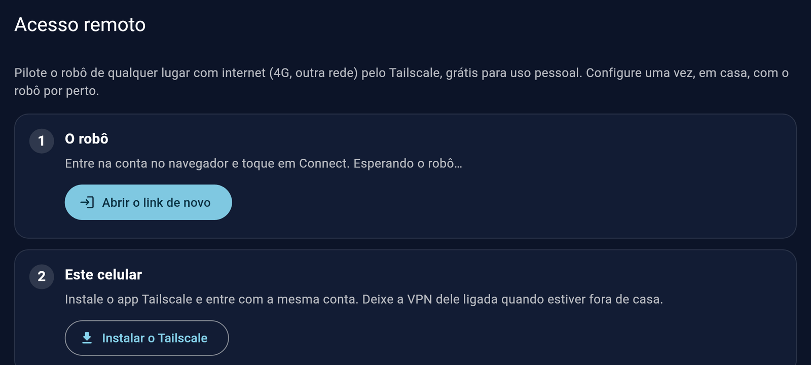

# Acesso remoto (Tailscale)

[English](remote-access.md) · **Português**

Pilote o robô de qualquer lugar com internet (4G, o Wi-Fi de um amigo, outra cidade) como se estivesse em casa. Ele usa o [Tailscale](https://tailscale.com), uma rede privada entre os seus próprios aparelhos: grátis para uso pessoal, nada para abrir no roteador, e ninguém fora da sua conta alcança o robô.

Você configura **uma vez, em casa**, pelo app. Depois o app acha o robô sozinho: na mesma rede ele vai direto, fora de casa ele vai pelo Tailscale.

## Do que você precisa

- O robô pareado com o app ([instalar.md](instalar.md)).
- **O celular na mesma rede do robô** durante a configuração (o Wi-Fi de casa, ou a rede própria do robô, **Hexapode-…**).
- Uma conta no Tailscale: você cria no primeiro login, com Google, Microsoft, GitHub ou e-mail.

## Passo a passo

### 1. Abra a tela

No app: **Ajustes → Acesso remoto**.

### 2. Conecte o robô

Toque em **Conectar o robô**. O navegador do celular abre o login do Tailscale:

1. Entre (ou crie a conta) com Google, Microsoft, GitHub...
2. O Tailscale pergunta se quer adicionar o aparelho **hexapod-xxxx** (o seu robô): toque em **Connect**.
3. Volte para o app. A tela fica esperando o robô; se o navegador fechou antes da hora, toque em **Abrir o link de novo**.

Em alguns segundos o passo 1 fica verde: **No Tailscale como hexapod-xxxx**, com a conta e o endereço do robô.

### 3. Coloque este celular no Tailscale

O celular também precisa estar na sua rede Tailscale:

1. Toque em **Instalar o Tailscale** (Google Play).
2. Abra o app do Tailscale, entre com **a mesma conta** e permita a VPN quando o Android pedir.

De volta no app do robô, o passo 2 fica verde: **Este celular está no Tailscale**.

### 4. Pronto: use fora de casa

- Deixe a **VPN do Tailscale ligada** no celular quando estiver fora (o app do Tailscale tem um botão rápido; parado, ele quase não gasta bateria).
- Abra o app do robô como sempre: ele acha o robô pelo Tailscale sozinho. O vídeo também funciona.
- Em casa nada muda: o app vai direto ao robô pela sua rede.

Para testar sem sair de casa: desligue o Wi-Fi do celular e use os dados móveis.

## Outros aparelhos

Instale o Tailscale num PC, tablet ou outro celular com a mesma conta e eles também alcançam o robô (o app do robô só no Android; no PC: o vídeo no navegador em `http://hexapod-xxxx:8889/cam`, e SSH para os makers).

## Desligando

**Ajustes → Acesso remoto → Desconectar** tira o robô do Tailscale. Faça isso **em casa**: se você estiver conectado pelo Tailscale agora (no 4G), perde o acesso ao robô e só consegue conectar de novo da mesma rede dele. O app avisa antes.

Também dá para remover o robô no painel do Tailscale ([login.tailscale.com](https://login.tailscale.com/admin/machines)).

## Quando algo dá errado

| O que acontece | O que fazer |
|---|---|
| "Não consigo falar com o robô" na tela | A configuração precisa do celular na mesma rede do robô: entre no Wi-Fi de casa (ou na rede **Hexapode-…** do robô) e abra a tela de novo |
| O navegador não abriu, ou foi fechado | **Abrir o link de novo** (o link é de uso único e vence em alguns minutos; tocar de novo gera outro) |
| O passo 1 continua esperando depois do login | Confira se tocou em **Connect** no navegador e espere alguns segundos |
| Fora de casa o app não conecta | A VPN do Tailscale no celular está desligada: ligue no app do Tailscale |
| "O Tailscale não está instalado neste robô" | Atualize a imagem do cartão (ou, makers: rode o playbook de provisionamento) |

Makers: o mesmo pelo terminal, e como funciona por dentro, em [`instalacao-maker.md`](instalacao-maker.md#5-acesso-remoto-opcional).
