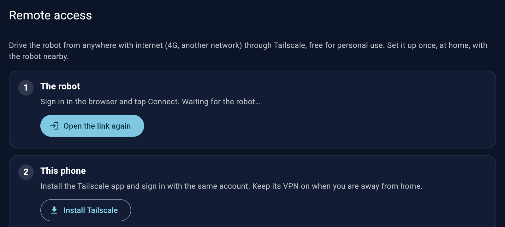

# Remote access (Tailscale)

**English** · [Português](acesso-remoto.md)

Drive the robot from anywhere with internet (4G, a friend's Wi-Fi, another city) as if you were at home. It uses [Tailscale](https://tailscale.com), a private network between your own devices: free for personal use, nothing to open on your router, and nobody outside your account can reach the robot.

You set it up **once, at home**, from the app. Afterwards the app finds the robot by itself: on the same network it goes direct, away from home it goes through Tailscale.

## What you need

- The robot paired with the app ([install.md](install.md)).
- **The phone on the same network as the robot** while setting it up (your home Wi-Fi, or the robot's own **Hexapode-…** network).
- A Tailscale account: you create it during the first login, with Google, Microsoft, GitHub or an e-mail.

## Step by step

### 1. Open the screen

In the app: **Settings → Remote access**.

### 2. Connect the robot

Tap **Connect the robot**. The phone's browser opens the Tailscale login:

1. Sign in (or create the account) with Google, Microsoft, GitHub...
2. Tailscale asks whether to add the device **hexapod-xxxx** (your robot): tap **Connect**.
3. Come back to the app. The screen waits for the robot; if the browser closed too early, tap **Open the link again**.

Within a few seconds, step 1 turns green: **On Tailscale as hexapod-xxxx**, with the account and the robot's address.

### 3. Put this phone on Tailscale

The phone also has to be on your Tailscale network:

1. Tap **Install Tailscale** (Google Play).
2. Open the Tailscale app, sign in with **the same account** and allow the VPN when Android asks.

Back in the robot's app, step 2 turns green: **This phone is on Tailscale**.

### 4. Done: use it away from home

- Keep the **Tailscale VPN on** on the phone when you are out (the Tailscale app has a quick switch; it uses almost no battery while idle).
- Open the robot's app as usual: it finds the robot through Tailscale by itself. Video works too.
- At home nothing changes: the app goes straight to the robot on your network.

To test without leaving home: turn the phone's Wi-Fi off and use mobile data.

## Other devices

Install Tailscale on a PC, a tablet or another phone with the same account and they reach the robot too (the robot's app only on Android; on a PC: the video in a browser at `http://hexapod-xxxx:8889/cam`, and SSH for makers).

## Turning it off

**Settings → Remote access → Disconnect** takes the robot off Tailscale. Do it **from home**: if you are connected through Tailscale right now (on 4G), you lose access to the robot and can only connect it again from the same network as it. The app warns you before.

You can also remove the robot in the Tailscale admin console ([login.tailscale.com](https://login.tailscale.com/admin/machines)).

## When something goes wrong

| What happens | What to do |
|---|---|
| "Can't reach the robot" in the screen | The setup needs the phone on the same network as the robot: join your home Wi-Fi (or the robot's **Hexapode-…** network) and open the screen again |
| The browser didn't open, or it was closed | **Open the link again** (the link is single-use and expires in a few minutes; tapping again makes a new one) |
| Step 1 stays waiting after logging in | Check you tapped **Connect** in the browser, then wait a few seconds |
| Away from home the app doesn't connect | The Tailscale VPN on the phone is off: turn it on in the Tailscale app |
| "Tailscale is not installed on this robot" | Update the SD card image (or, makers: run the provisioning playbook) |

Makers: the same from a terminal, and how it works inside, in [`maker-install.md`](maker-install.md#5-remote-access-optional).
